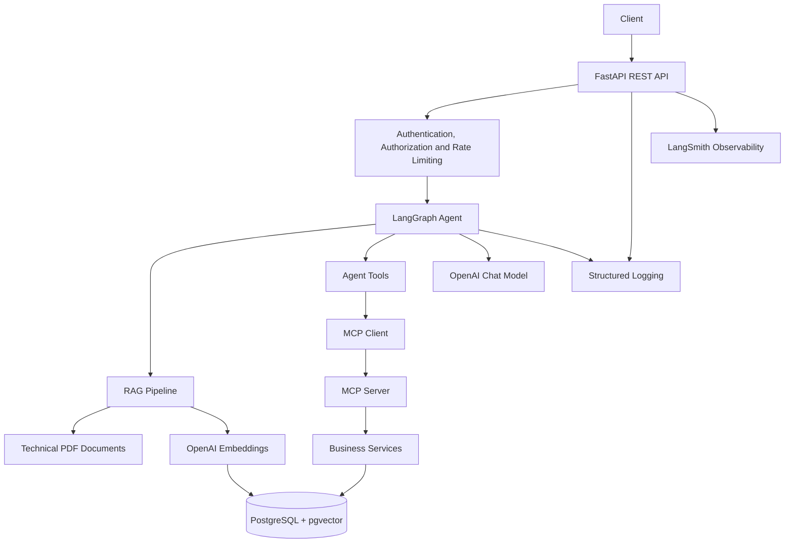

# Aurelia AI Support Agent

An AI-powered customer support agent built with Python, FastAPI, LangGraph, LangChain, PostgreSQL, pgvector and OpenAI.

Aurelia AI Support Agent is a modular AI application designed for Aurelia Industrial Systems, a fictional industrial company. It combines Retrieval-Augmented Generation (RAG), LLM-based reasoning, enterprise tools and the Model Context Protocol (MCP) to support customer service operations.

The project demonstrates how to build an AI agent that integrates technical documentation retrieval with structured business operations, authentication, authorization, observability, automated testing and containerization.

## Features

- REST API built with FastAPI
- LangGraph-based agent orchestration
- Retrieval-Augmented Generation (RAG) over technical documentation
- PDF document processing and chunking
- OpenAI chat model and embeddings integration
- PostgreSQL database with pgvector for vector similarity search
- Agent tools for customer support and enterprise operations
- MCP server exposing business capabilities to AI agents
- Customer, order, shipment, product, machine, maintenance and support ticket operations
- JWT-based authentication and authorization
- Role-based access control
- API rate limiting
- Centralized exception handling
- Structured application logging
- Input validation and security safeguards
- Unit, integration and evaluation tests
- Docker and Docker Compose support
- GitHub Actions continuous integration
- Automated Docker image build
- LangSmith tracing configuration

## Architecture



## How It Works

1. A client sends a support request to the FastAPI application.
2. The API applies rate limiting and the relevant authentication and authorization checks.
3. The request is processed by the agent orchestration layer.
4. The agent can retrieve relevant information from technical documentation through the RAG pipeline.
5. When required, the agent can use tools to access enterprise data or perform supported business operations.
6. The MCP server exposes selected business capabilities through a standardized tool interface.
7. The application returns the response to the client while using centralized error handling and structured logging.

The exact execution path depends on the request and the tools selected by the agent.

## Main Components

### API Layer

Located in `main.py` and `src/api/`.

The API exposes the application's HTTP endpoints through FastAPI. It configures application-wide rate limiting, logging, exception handling and registers the authentication and chat routers.

### AI Agent

Located in `src/agent/`.

The agent uses LangGraph to orchestrate the request-processing workflow and coordinate the available capabilities.

### RAG Pipeline

Located in `src/rag/`.

The RAG component supports retrieving relevant information from technical documentation. Document embeddings are stored in PostgreSQL with pgvector, enabling semantic similarity search.

### LLM Integration

Located in `src/llm/`.

The application integrates OpenAI models for language generation and embeddings. Model settings, request timeouts and retry behavior are configurable through environment variables.

### Database Layer

Located in `src/database/`.

The database layer provides the application's PostgreSQL connectivity and session management. PostgreSQL with pgvector supports both structured business data and vector-based retrieval.

### Business Services and Tools

Located in `src/services/` and `src/tools/`.

The services encapsulate business operations used by the application and MCP tools, including:

- Customer information retrieval
- Order status retrieval, creation and cancellation
- Shipment tracking
- Machine status and maintenance history
- Product information retrieval
- Support ticket retrieval, creation and updates

Business services centralize the operations performed against the enterprise database.

### Model Context Protocol (MCP)

Located in `src/mcp/`.

The MCP server exposes business capabilities through tools that an MCP client can invoke. It is implemented using `MCPServer` and uses streamable HTTP transport on port `8001`.

The available tools include:

- `get_order_status_tool`
- `get_customer_tool`
- `track_shipment_tool`
- `get_machine_status_tool`
- `get_maintenance_history_tool`
- `get_support_ticket_tool`
- `get_product_tool`
- `create_order_tool`
- `cancel_order_tool`
- `create_support_ticket_tool`
- `update_support_ticket_tool`

The MCP client is configured to connect to `http://localhost:8001/mcp` during local development.

### Authentication and Security

Located in `src/auth/` and `src/security/`.

The application includes JWT-based authentication, authorization controls, request rate limiting and input validation. These mechanisms help protect API endpoints and restrict access to supported operations.

### Logging and Observability

Located in `src/logging/`.

The application configures centralized structured logging and consistent error handling. LangSmith tracing can be enabled through environment variables to support workflow inspection and debugging.

### Evaluation

Located in `src/evaluation/`, `tests/evaluation/`, and `scripts/run_evaluation.py`.

The project includes an evaluation pipeline for validating the evaluation dataset and assessing the behavior of the AI agent.

The evaluation script supports two modes:

- **Deterministic evaluation:** validates the dataset structure, required fields, supported categories, and expected values without executing the agent.
- **Live evaluation:** executes the evaluation cases against the LangGraph agent and evaluates the results against the expected outcomes.

The evaluation dataset is stored in `data/evaluation/evaluation_dataset.json`.

Run the live evaluation from the repository root:

```bash
python -m scripts.run_evaluation
```

The live evaluation requires the database, the vector store, the configured language model, and the services needed by the agent to be available.

## Tech Stack

| Category | Technologies |
|---|---|
| Language | Python 3.13 |
| API | FastAPI |
| Agent orchestration | LangGraph |
| LLM framework | LangChain |
| Language model | OpenAI, default `gpt-4o-mini` |
| Embeddings | OpenAI `text-embedding-3-small` |
| Database | PostgreSQL |
| Vector search | pgvector |
| Tool integration | Model Context Protocol (MCP) |
| Authentication | JWT |
| Testing | pytest, pytest-asyncio |
| Observability | Structured logging, LangSmith |
| Containerization | Docker, Docker Compose |
| CI | GitHub Actions |

## Project Structure

```text
aurelia-ai-support-agent/
├── .github/
│   └── workflows/
│       └── ci.yml
├── data/
│   ├── documents/
│   └── evaluation/
├── scripts/
│   ├── ingest_documents.py
│   ├── init_database.py
│   ├── run_evaluation.py
│   └── seed_database.py
├── src/
│   ├── agent/
│   ├── api/
│   ├── auth/
│   ├── database/
│   ├── evaluation/
│   ├── llm/
│   ├── logging/
│   ├── mcp/
│   ├── rag/
│   ├── security/
│   ├── services/
│   └── tools/
├── tests/
│   ├── unit/
│   ├── integration/
│   └── evaluation/
├── .dockerignore
├── .env.example
├── .gitignore
├── Dockerfile
├── docker-compose.yaml
├── main.py
├── pytest.ini
├── requirements.txt
└── README.md
```

## Requirements

- Python 3.13
- Docker Desktop or Docker Engine with Docker Compose
- An OpenAI API key for model and embedding calls
- A LangSmith API key if tracing is enabled and remote tracing is required

## Installation

Clone the repository:

```bash
git clone https://github.com/francescomv98/aurelia-ai-support-agent.git
cd aurelia-ai-support-agent
```

Create and activate a virtual environment.

Windows:

```powershell
python -m venv .venv
.venv\Scripts\Activate.ps1
```

Linux or macOS:

```bash
python -m venv .venv
source .venv/bin/activate
```

Install the dependencies:

```bash
python -m pip install --upgrade pip
pip install -r requirements.txt
```

## Environment Configuration

Create a local `.env` file using `.env.example` as a template.

Configure the following variables:

| Variable | Description |
|---|---|
| `DATABASE_URL` | SQLAlchemy connection string for PostgreSQL |
| `POSTGRES_PASSWORD` | PostgreSQL password used by Docker Compose |
| `OPENAI_API_KEY` | API key for OpenAI model and embedding calls |
| `OPENAI_MODEL` | OpenAI chat model; defaults to `gpt-4o-mini` |
| `OPENAI_TIMEOUT_SECONDS` | Request timeout for OpenAI calls |
| `OPENAI_MAX_RETRIES` | Maximum number of retries for OpenAI calls |
| `RATE_LIMIT_REQUESTS` | Maximum number of requests allowed in the configured time window |
| `RATE_LIMIT_WINDOW_SECONDS` | Rate-limiting window in seconds |
| `JWT_SECRET_KEY` | Secret used for JWT signing |
| `JWT_ALGORITHM` | JWT signing algorithm |
| `JWT_ACCESS_TOKEN_EXPIRE_MINUTES` | JWT access token lifetime |
| `LANGSMITH_TRACING` | Enables or disables LangSmith tracing |
| `LANGSMITH_API_KEY` | LangSmith API key |
| `LANGSMITH_PROJECT` | LangSmith project name |
| `LANGSMITH_ENDPOINT` | LangSmith API endpoint |

Keep real credentials in `.env` and never commit that file to version control. Use suitable secrets for any environment beyond local development.

## Database Setup

Start PostgreSQL with pgvector:

```bash
docker compose up -d postgres
```

Initialize the database schema:

```bash
python -m scripts.init_database
```

Seed the database with the sample data:

```bash
python -m scripts.seed_database
```

Ensure the database is available and that `DATABASE_URL` matches the database credentials and connection settings before starting the application.

## Document Ingestion

The `scripts/ingest_documents.py` script populates the RAG knowledge base using the technical documents stored in `data/documents/`.

The ingestion pipeline:

1. Loads the available documents.
2. Splits the documents into smaller chunks.
3. Generates embeddings using the configured embedding model.
4. Stores the chunks and their embeddings in PostgreSQL with pgvector.

Before running the script, ensure that PostgreSQL is running, the database is initialized and the required environment variables are configured.

Run the ingestion pipeline from the repository root:

```bash
python -m scripts.ingest_documents
```

Run this script to populate the vector store before testing workflows that rely on document retrieval.

## Running the Application Locally

Start the MCP server in a separate terminal:

```bash
python -m src.mcp.server
```

The MCP server uses streamable HTTP transport on port `8001`.

Then start the FastAPI application from the repository root:

```bash
uvicorn main:app --reload
```

The API documentation is available at:

[http://localhost:8000/docs](http://localhost:8000/docs)

The MCP client is configured for the local MCP endpoint:

`http://localhost:8001/mcp`

Keep the database and MCP server running while executing application workflows that depend on them.

## Running with Docker Compose

Make sure `.env` contains the required PostgreSQL password and the other environment variables needed by the application.

Build and start the configured services:

```bash
docker compose up -d --build
```

Inspect service status:

```bash
docker compose ps
```

View application logs:

```bash
docker compose logs -f api
```

View PostgreSQL logs:

```bash
docker compose logs -f postgres
```

Stop the services:

```bash
docker compose down
```

The PostgreSQL data is stored in a Docker volume. To remove the database volume as well, use `docker compose down -v`; this deletes the persisted local database data.

## Testing

Run the unit tests:

```bash
python -m pytest tests/unit -v
```

Run the integration tests:

```bash
python -m pytest tests/integration -v
```

Run the evaluation tests:

```bash
python -m pytest tests/evaluation -v
```

Integration and evaluation tests may require a configured database, initialized sample data, or other services depending on the individual test.

## Continuous Integration

The GitHub Actions workflow in `.github/workflows/ci.yml` automates selected validation steps.

The workflow:

1. Checks out the repository.
2. Sets up the Python environment and installs dependencies.
3. Starts a PostgreSQL service with pgvector.
4. Initializes and seeds the database.
5. Starts the MCP server for the test environment.
6. Executes the unit test suite.
7. Builds the Docker image after the test job succeeds.

The Docker image is built as a CI validation step. The workflow does not publish the image to a container registry or deploy the application to a remote environment.

## Project Goals

This project explores the development of a modular AI support application that combines:

- Agent orchestration with LangGraph
- Retrieval-Augmented Generation over technical documentation
- Structured enterprise data access
- Tool integration through MCP
- API authentication and authorization
- Automated testing and evaluation
- Logging and LLM observability
- Containerization and continuous integration

It is intended as a practical demonstration of AI engineering and software engineering practices for building an extensible support agent.

## License

No license has been specified for this repository.
