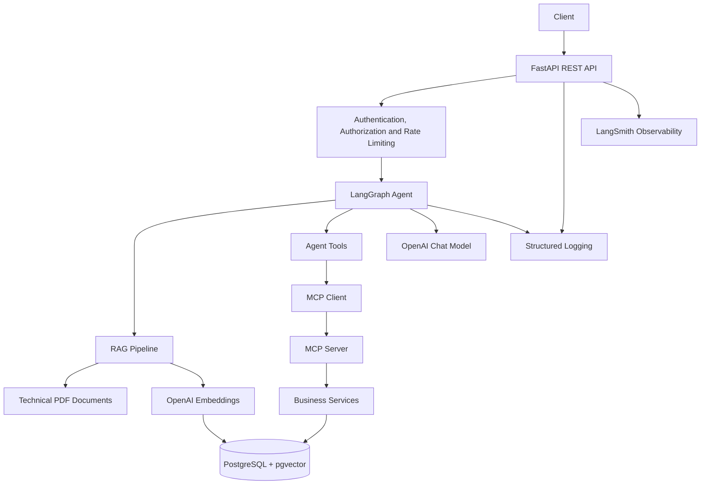

# Aurelia AI Support Agent

An AI-powered customer support agent built with Python, FastAPI, LangGraph, LangChain, PostgreSQL, pgvector and OpenAI.

Aurelia AI Support Agent is a modular AI application designed for Aurelia Industrial Systems, a fictional industrial company. It combines Retrieval-Augmented Generation (RAG), LLM-based reasoning, enterprise tools and the Model Context Protocol (MCP) to support customer service operations.

The project demonstrates how to build an AI agent that integrates technical documentation retrieval with structured business operations, authentication, authorization, observability, automated testing and containerization.

## Features

- REST API built with FastAPI
- LangGraph-based agent orchestration
- Retrieval-Augmented Generation (RAG) over technical documentation
- PDF document processing and chunking
- OpenAI chat model and embeddings integration
- PostgreSQL database with pgvector for vector similarity search
- Agent tools for customer support and enterprise operations
- MCP server exposing business capabilities to AI agents
- Customer, order, shipment, product, machine, maintenance and support ticket operations
- JWT-based authentication and authorization
- Role-based access control
- API rate limiting
- Centralized exception handling
- Structured application logging
- Input validation and security safeguards
- Unit, integration and evaluation tests
- Docker and Docker Compose support
- GitHub Actions continuous integration
- Continuous delivery of Docker images to GitHub Container Registry
- LangSmith tracing configuration

## Architecture



## How It Works

1. A client sends a support request to the FastAPI application.
2. The API applies rate limiting and the relevant authentication and authorization checks.
3. The request is processed by the agent orchestration layer.
4. The agent can retrieve relevant information from technical documentation through the RAG pipeline.
5. When required, the agent can use tools to access enterprise data or perform supported business operations.
6. The MCP server exposes selected business capabilities through a standardized tool interface.
7. The application returns the response to the client while using centralized error handling and structured logging.

The exact execution path depends on the request and the tools selected by the agent.

## Main Components

### API Layer

Located in `main.py` and `src/api/`.

The API exposes the application's HTTP endpoints through FastAPI. It configures application-wide rate limiting, logging, exception handling and registers the authentication and chat routers.

### AI Agent

Located in `src/agent/`.

The agent uses LangGraph to orchestrate the request-processing workflow and coordinate the available capabilities.

Write actions (creating or cancelling an order, creating or updating a support ticket) pause the workflow and return `status: "approval_required"`. The customer who made the request confirms or rejects the action through `POST /chat/resume`. This is a user confirmation step, not an approval by a second person.

For maintenance-status questions, the maintenance interval is read from the `products` table (`maintenance_interval_hours`). The retrieved documentation is used only as context for the answer.

### RAG Pipeline

Located in `src/rag/`.

The RAG component supports retrieving relevant information from technical documentation. Document embeddings are stored in PostgreSQL with pgvector, enabling semantic similarity search.

Documents are split into chunks of up to 500 characters with a 100-character overlap. The pages of each PDF are chunked as one continuous text, so a table that crosses a page break stays together, and each chunk keeps the number of the page it starts on. Each chunk also starts with its document's title, for example `[AIS-100 Technical Specifications]`, so that chunks such as specification tables are linked to the product they describe. These settings were chosen with the RAG evaluation below. After changing them, re-run `python -m scripts.ingest_documents`.

Every chunk carries this metadata (built in `src/rag/document_metadata.py`):

| Field | Example | Origin |
|---|---|---|
| `document_id` | `5d3ce3c9-21d8-580b-8705-a3bc8ca4e705` | UUID v5 of the file name: stable across ingestions, new if the file is renamed |
| `source`, `category` | `AIS-500_user_manual.pdf`, `manuals` | File name and folder |
| `page`, `total_pages` | `1`, `9` | PDF page (0-based) and page count |
| `product` | `AIS-500` (`null` for general documents) | File name prefix |
| `doc_type` | `user_manual` | File name without the product |
| `title` | `AIS-500 User Manual` | File name |
| `chunk_index` | `3` | Position of the chunk in its file, from 0 |
| `date` | `2026-01-15` | Effective date, from the owner manifest |
| `valid` | `true` | Owner manifest; `false` withdraws the document |
| `reviewed_at` | `2026-11-12T10:00:00+00:00` or `null` | Time of the last owner review (UTC), from the owner manifest |

Other fields extracted from the PDF (producer, creator, author, PDF timestamps) are dropped.

Retrieval (`src/rag/retriever.py`) uses this metadata to filter the vector search:

- Only chunks with `valid: true` are searched.
- When the question names a product (`AIS-200`, `AIS 200`, `ais200`), the search is limited to the chunks of that product and the general documents (`product: null`, such as the FAQ, maintenance guides and policies). The manuals and specifications of the three models are very similar, so without this filter chunks about the other models can push out the right ones. A question that names several products keeps all of them.

Each retrieved chunk is passed to the LLM with a header such as `[Source: AIS-200 User Manual (AIS-200_user_manual.pdf) | Page: 4 | Category: manuals | Product: AIS-200 | Effective date: 2026-01-15 | Last reviewed: never]`. Pages are numbered from 1, as in the PDF viewer.

### LLM Integration

Located in `src/llm/`.

The application integrates OpenAI models for language generation and embeddings. Model settings, request timeouts and retry behavior are configurable through environment variables.

#### Handling of temporary failures

`POST /chat` depends on OpenAI, PostgreSQL and the MCP server. Each is handled as follows:

| Dependency | Timeout and retries | If it is still unavailable |
|---|---|---|
| OpenAI chat model (routing and answer) | `OPENAI_TIMEOUT_SECONDS` (default 30). The OpenAI SDK retries rate limits, 5xx responses, timeouts and connection errors up to `OPENAI_MAX_RETRIES` times (default 2), with exponential backoff | `503`, "The AI service is temporarily unavailable." |
| OpenAI embeddings (RAG query) | Same settings as the chat model | The agent answers without documentation instead of failing the request |
| PostgreSQL vector store | Stale connections are detected (`pool_pre_ping`) | The agent answers without documentation |
| MCP server (orders, shipments, machines, tickets) | No automatic retry | `503`, "An external service is temporarily unavailable." This includes an unreachable server |

MCP calls are deliberately not retried. Write tools (create or cancel an order, create or update a ticket) are not idempotent: if the server completed the action but the response was lost, a retry would repeat it, for example by creating a second order. Read tools could be retried safely, but this is not implemented yet.

### Database Layer

Located in `src/database/`.

The database layer provides the application's PostgreSQL connectivity and session management. PostgreSQL with pgvector supports both structured business data and vector-based retrieval.

### Business Services and Tools

Located in `src/services/` and `src/tools/`.

The services encapsulate business operations used by the application and MCP tools. `src/tools/` holds the two authorization wrappers the agent calls directly for the hybrid machine flow (machine data and machine tickets). The operations include:

- Customer information retrieval
- Order status retrieval, creation and cancellation
- Shipment tracking
- Machine status and maintenance history
- Product information retrieval
- Support ticket retrieval, creation and updates

Business services centralize the operations performed against the enterprise database.

### Model Context Protocol (MCP)

Located in `src/mcp/`.

The MCP server exposes business capabilities through tools that an MCP client can invoke. It is implemented using `MCPServer` and uses streamable HTTP transport on port `8001`.

The available tools include:

- `get_order_status_tool`
- `get_customer_tool`
- `track_shipment_tool`
- `get_machine_status_tool`
- `get_maintenance_history_tool`
- `get_support_ticket_tool`
- `get_product_tool`
- `create_order_tool`
- `cancel_order_tool`
- `create_support_ticket_tool`
- `update_support_ticket_tool`

The MCP client is configured to connect to `http://localhost:8001/mcp` during local development.

### Authentication and Security

Located in `src/auth/` and `src/security/`.

The application includes JWT-based authentication, authorization controls, request rate limiting and input validation. These mechanisms help protect API endpoints and restrict access to supported operations.

The chat endpoints serve customers only. `SUPPORT_AGENT` and `ADMIN` users receive `403 Forbidden` from `/chat` and `/chat/resume`, and every agent operation runs for the authenticated customer's own `customer_id`.

The document review endpoints (`/admin/documents/...`, see [Document reviews](#document-reviews)) are for `ADMIN` users only; any other role receives `403 Forbidden`.

### Logging and Observability

Located in `src/app_logging/`.

The application configures centralized structured logging and consistent error handling. LangSmith tracing can be enabled through environment variables to support workflow inspection and debugging.

### Evaluation

Located in `src/evaluation/`, `tests/evaluation/` and `scripts/run_evaluation.py`.

The project includes an evaluation pipeline for validating the evaluation dataset and assessing the behavior of the AI agent.

The evaluation script supports two modes:

- **Deterministic evaluation:** validates the dataset structure, required fields, supported categories, and expected values without executing the agent.
- **Live evaluation:** executes the evaluation cases against the LangGraph agent and evaluates the results against the expected outcomes.

The evaluation dataset is stored in `data/evaluation/evaluation_dataset.json`.

Run the live evaluation from the repository root:

```bash
python -m scripts.run_evaluation
```

The live evaluation requires the database, the vector store, the configured language model and the services needed by the agent to be available.

### RAG Evaluation

Located in `src/evaluation/rag/`, `tests/evaluation/rag/`, `data/evaluation/rag/` and `scripts/evaluate_rag.py`.

The RAG pipeline is evaluated one stage at a time, so a failure points to the stage that caused it:

| Stage | Question it answers | Metrics | Needs |
|---|---|---|---|
| Ingestion | Did the PDFs become complete, well-formed chunks? | PDFs loaded, pages with text, chunk metadata, chunk size, duplicates, fact coverage, optional vector-store count | Nothing (offline) |
| Retrieval | Does the vector search return the right chunks? | Hit rate, MRR, fact recall, context precision | Database with ingested documents, OpenAI key |
| Generation | Given the right context, is the answer correct and grounded? | Answer correctness, abstention on unanswerable questions, groundedness (no invented numbers) | OpenAI key |

Generation uses a fixed "gold" context taken from the ingested chunks instead of the retriever, and runs the same `generate_response` node the agent uses. A generation failure is therefore a prompt or model problem, not a retrieval problem.

Run all stages, or one stage, from the repository root:

```bash
python -m scripts.evaluate_rag
python -m scripts.evaluate_rag --stage ingestion --check-store
python -m scripts.evaluate_rag --stage retrieval --top-k 4
python -m scripts.evaluate_rag --stage retrieval --no-product-filter   # baseline without the product filter
python -m scripts.evaluate_rag --check-store --output data/evaluation/rag/rag_report.json
```

Each stage prints its checks with thresholds, and the script exits with a non-zero code when a check fails. Warnings, such as a PDF page with no extractable text, are reported without failing the stage. The metric logic, the datasets and the ingestion of the real PDFs are also covered by `pytest tests/evaluation/rag`, which runs offline in CI.

## Tech Stack

| Category | Technologies |
|---|---|
| Language | Python 3.13 |
| API | FastAPI |
| Agent orchestration | LangGraph |
| LLM framework | LangChain |
| Language model | OpenAI, default `gpt-4o-mini` |
| Embeddings | OpenAI `text-embedding-3-small` |
| Database | PostgreSQL |
| Vector search | pgvector |
| Tool integration | Model Context Protocol (MCP) |
| Authentication | JWT |
| Testing | pytest, pytest-asyncio, pytest-cov |
| Code quality | ruff, pip-audit |
| Observability | Structured logging, LangSmith |
| Containerization | Docker, Docker Compose |
| CI | GitHub Actions, Azure Pipelines |
| CD | GitHub Actions, GitHub Container Registry |

## Project Structure

```text
aurelia-ai-support-agent/
├── .github/
│   └── workflows/
│       ├── cd.yml
│       └── ci.yml
├── data/
│   ├── documents/
│   └── evaluation/
├── scripts/
│   ├── evaluate_rag.py
│   ├── ingest_documents.py
│   ├── init_database.py
│   ├── run_evaluation.py
│   └── seed_database.py
├── src/
│   ├── agent/
│   ├── api/
│   ├── auth/
│   ├── database/
│   ├── evaluation/
│   ├── llm/
│   ├── app_logging/
│   ├── mcp/
│   ├── rag/
│   ├── security/
│   ├── services/
│   └── tools/
├── tests/
│   ├── unit/
│   ├── integration/
│   └── evaluation/
├── .dockerignore
├── .env.example
├── .gitignore
├── azure-pipelines.yml
├── Dockerfile
├── docker-compose.yaml
├── main.py
├── pytest.ini
├── requirements.txt
├── ruff.toml
└── README.md
```

## Requirements

- Python 3.13
- Docker Desktop or Docker Engine with Docker Compose
- An OpenAI API key for model and embedding calls
- A LangSmith API key if tracing is enabled and remote tracing is required

## Installation

Clone the repository:

```bash
git clone https://github.com/francescomv98/aurelia-ai-support-agent.git
cd aurelia-ai-support-agent
```

Create and activate a virtual environment.

Windows:

```powershell
python -m venv .venv
.venv\Scripts\Activate.ps1
```

Linux or macOS:

```bash
python -m venv .venv
source .venv/bin/activate
```

Install the dependencies:

```bash
python -m pip install --upgrade pip
pip install -r requirements.txt
```

`requirements.txt` is the only requirements file. It lists the project's direct dependencies, pinned, and pip resolves their transitive dependencies. It includes the test and lint tools (`pytest`, `pytest-asyncio`, `pytest-cov`, `httpx` for the FastAPI test client, `ruff`), so one install is enough to run the application and the test suite:

```bash
ruff check .
python -m pytest tests/unit tests/evaluation
```

The dependency audit tool is not a project dependency. Install it separately when you need it, as CI does:

```bash
pip install pip-audit==2.10.1
pip-audit -r requirements.txt
```

## Environment Configuration

Create a local `.env` file using `.env.example` as a template.

Configure the following variables:

| Variable | Description |
|---|---|
| `DATABASE_URL` | SQLAlchemy connection string for PostgreSQL |
| `POSTGRES_PASSWORD` | PostgreSQL password used by Docker Compose |
| `OPENAI_API_KEY` | API key for OpenAI model and embedding calls |
| `OPENAI_MODEL` | OpenAI chat model; defaults to `gpt-4o-mini` |
| `OPENAI_TIMEOUT_SECONDS` | Request timeout for OpenAI chat and embedding calls; defaults to `30` |
| `OPENAI_MAX_RETRIES` | Maximum number of retries, with exponential backoff, for OpenAI chat and embedding calls; defaults to `2` |
| `RATE_LIMIT_REQUESTS` | Maximum number of requests allowed in the configured time window |
| `RATE_LIMIT_WINDOW_SECONDS` | Rate-limiting window in seconds |
| `JWT_SECRET_KEY` | Secret used for JWT signing |
| `JWT_ALGORITHM` | JWT signing algorithm |
| `JWT_ACCESS_TOKEN_EXPIRE_MINUTES` | JWT access token lifetime |
| `LANGSMITH_TRACING` | Enables or disables LangSmith tracing |
| `LANGSMITH_API_KEY` | LangSmith API key |
| `LANGSMITH_PROJECT` | LangSmith project name |
| `LANGSMITH_ENDPOINT` | LangSmith API endpoint |

Keep real credentials in `.env` and never commit that file to version control. Use suitable secrets for any environment beyond local development.

## Database Setup

Start PostgreSQL with pgvector:

```bash
docker compose up -d postgres
```

Initialize the database schema:

```bash
python -m scripts.init_database
```

Seed the database with the sample data:

```bash
python -m scripts.seed_database
```

### Demo users

The seed script creates these users. **All of them have the same password: `AureliaDemo123!`** You can set a different one with the `AURELIA_DEMO_PASSWORD` environment variable before seeding. Re-running the seed script resets every demo user to that password.

| Username | Password | Role | Customer |
|---|---|---|---|
| `alfa.support` | `AureliaDemo123!` | `CUSTOMER` | CUST-001, Alfa Manufacturing S.p.A. |
| `beta.operations` | `AureliaDemo123!` | `CUSTOMER` | CUST-002, Beta Automation GmbH |
| `gamma.manager` | `AureliaDemo123!` | `CUSTOMER` | CUST-003, Gamma Industries S.r.l. |
| `delta.maintenance` | `AureliaDemo123!` | `CUSTOMER` | CUST-004, Delta Mechanics S.A. |
| `nova.operator` | `AureliaDemo123!` | `CUSTOMER` | CUST-005, Nova Production Ltd. |
| `mario.rossi` | `AureliaDemo123!` | `SUPPORT_AGENT` | — |
| `lucia.bianchi` | `AureliaDemo123!` | `SUPPORT_AGENT` | — |
| `admin.system` | `AureliaDemo123!` | `ADMIN` | — |

What each role can do:
- **Customers** can use `/chat` and `/chat/resume`.
- **`admin.system`** can use the document review endpoints (`/admin/documents/...`).
- **Support agents** can log in, but no endpoint is open to them yet.

Get a token with:

```bash
curl -X POST http://localhost:8000/auth/login -H "Content-Type: application/json"      -d '{"username": "alfa.support", "password": "AureliaDemo123!"}'
```

These are development-only credentials for the sample data. Never seed them into a shared or production database.

Ensure the database is available and that `DATABASE_URL` matches the database credentials and connection settings before starting the application.

## Document Ingestion

The `scripts/ingest_documents.py` script populates the RAG knowledge base using the technical documents stored in `data/documents/`.

The ingestion pipeline:

1. Loads the available documents.
2. Splits the documents into smaller chunks.
3. Generates embeddings using the configured embedding model.
4. Stores the chunks and their embeddings in PostgreSQL with pgvector.

Before running the script, ensure that PostgreSQL is running, the database is initialized and the required environment variables are configured.

Run the ingestion pipeline from the repository root:

```bash
python -m scripts.ingest_documents
```

Run this script to populate the vector store before testing workflows that rely on document retrieval.

### Document owner metadata

`data/documents/metadata.json` lets document owners manage each PDF without changing code:

```json
{
  "warranty_policy.pdf": {"date": "2026-01-01", "valid": true, "reviewed_at": "2026-06-01"}
}
```

- **`date`:** effective date (ISO `YYYY-MM-DD`). A test checks that it matches the "Effective Date" printed on the PDF's first page.
- **`valid`:** set it to `false` to withdraw a document. Retrieval only searches chunks with `valid: true`.
- **`reviewed_at`:** time of the last review (ISO date or timestamp; a plain date means midnight UTC), or `null` if the document was never reviewed. Normally set through the review API below.

Ingestion stops on a malformed entry (wrong date format, unknown field) or on an entry for a file that does not exist. A PDF without an entry is ingested with `valid: true` and empty dates, with a warning. After editing the manifest, re-run `python -m scripts.ingest_documents`: metadata is stored with the chunks, and `python -m scripts.evaluate_rag --stage ingestion --check-store` reports a store whose text or metadata is out of date.

### Document reviews

Every valid document should be reviewed at least once a year. Two endpoints, restricted to `ADMIN` users, support this:

| Endpoint | Purpose |
|---|---|
| `GET /admin/documents/review-due?days=365` | Lists the valid documents whose last review is more than `days` days old (default 365). A document never reviewed counts from its effective `date`; one with neither date is always listed. Withdrawn documents (`valid: false`) are skipped. Most overdue first, each with its `document_id`. |
| `POST /admin/documents/{document_id}/review` | Records a review now: sets `reviewed_at` to the current UTC time in `metadata.json`, then re-ingests **only that document** (its chunks are re-embedded and replace the old ones in the vector store). Returns the document and its new chunk count. Unknown id: `404`. |

```bash
curl -H "Authorization: Bearer $ADMIN_TOKEN" http://localhost:8000/admin/documents/review-due
curl -X POST -H "Authorization: Bearer $ADMIN_TOKEN" http://localhost:8000/admin/documents/5d3ce3c9-21d8-580b-8705-a3bc8ca4e705/review
```

The manifest is written first, because it is the source of truth. If re-indexing then fails (database or OpenAI unavailable), the endpoint returns `503` saying the review was saved. Retry the review, or run `python -m scripts.ingest_documents`. The new chunks are stored before the old ones are deleted, so the document stays searchable throughout.

With Docker Compose, `data/documents` is mounted into the `api` container so that recorded reviews survive a rebuild. The container runs as its own `app` user, so the API must be allowed to write there:

- **Windows and macOS (Docker Desktop):** nothing to do.
- **Linux:** the mounted folder belongs to your host user, and without write access a review returns `500`. Run this once from the repository root:

  ```bash
  chmod a+w data/documents data/documents/metadata.json
  ```

  The API saves the manifest by writing a new file and renaming it. After the first review, `metadata.json` therefore belongs to the container user. If you later need to edit it by hand, use `sudo`, or run `sudo chown $USER data/documents/metadata.json` first.

Reviews are serialized within one API process. Running several API replicas would need shared storage for the manifest instead of a local file.

## Running the Application Locally

Start the MCP server in a separate terminal:

```bash
python -m src.mcp.server
```

The MCP server uses streamable HTTP transport on port `8001`.

Then start the FastAPI application from the repository root:

```bash
uvicorn main:app --reload
```

The API documentation is available at:

[http://localhost:8000/docs](http://localhost:8000/docs)

A liveness endpoint, used by the Docker Compose health check and the CI smoke test, is available at `http://localhost:8000/health` and returns `{"status": "ok"}`.

The MCP client is configured for the local MCP endpoint:

`http://localhost:8001/mcp`

Keep the database and MCP server running while executing application workflows that depend on them.

## Running with Docker Compose

Make sure `.env` contains the required PostgreSQL password and the other environment variables needed by the application.

On Linux, first allow the API container to write the document manifest (see [Document reviews](#document-reviews)):

```bash
chmod a+w data/documents data/documents/metadata.json
```

Build and start the configured services:

```bash
docker compose up -d --build
```

On the first start the database is empty. Create the tables, load the sample data and demo users, and ingest the documents. The scripts run inside the `api` container, which already has the database connection and the OpenAI key:

```bash
docker compose exec api python -m scripts.init_database
docker compose exec api python -m scripts.seed_database
docker compose exec api python -m scripts.ingest_documents
```

The data is kept in the `postgres_data` volume, so these commands are only needed again after `docker compose down -v`, or `ingest_documents` after the documents change. Then log in with one of the [demo users](#demo-users).

Inspect service status:

```bash
docker compose ps
```

View application logs:

```bash
docker compose logs -f api
```

View PostgreSQL logs:

```bash
docker compose logs -f postgres
```

Stop the services:

```bash
docker compose down
```

The PostgreSQL data is stored in a Docker volume. To remove the database volume as well, use `docker compose down -v`; this deletes the persisted local database data.

## Testing

Run the unit tests:

```bash
python -m pytest tests/unit -v
```

Run the integration tests:

```bash
python -m pytest tests/integration -v
```

Run the evaluation tests:

```bash
python -m pytest tests/evaluation -v
```

Integration and evaluation tests may require a configured database, initialized sample data, or other services depending on the individual test.

Run the suites with a coverage report, as CI does:

```bash
python -m pytest tests/unit tests/evaluation --cov=src --cov-report=term-missing
```

`pytest.ini` adds the project root to the import path (`pythonpath = .`), so the plain `pytest` command works as well as `python -m pytest`.

## Continuous Integration and Delivery

The project follows Git Flow: `main` holds released code, `develop` collects finished work, and `feature/*`, `release/*` and `hotfix/*` branches are short-lived.

### CI (`.github/workflows/ci.yml`)

Runs on pull requests into `main` or `develop`, on pushes to `release/*` and `hotfix/*` branches, and inside the CD workflow. Its jobs run in parallel:

| Job | What it checks |
|---|---|
| Lint | `ruff check` (configured in `ruff.toml`) |
| Dependency audit | `pip-audit` on `requirements.txt`; fails on known vulnerabilities |
| Run tests | Unit, evaluation and integration tests against PostgreSQL (pgvector) and the MCP server, with a coverage report (minimum 80%) in the job summary |
| Build and smoke-test Docker image | Builds the image, starts it and waits for `GET /health` |

### CD (`.github/workflows/cd.yml`)

Runs on pushes to `develop` and `main` and on version tags (`v1.2.3`). It runs the full CI first and, only if it passes, publishes the image to GitHub Container Registry:

| Trigger | Image tags |
|---|---|
| Push to `develop` | `develop`, `sha-<commit>` |
| Push to `main` | `main`, `latest`, `sha-<commit>` |
| Tag `v1.2.3` | `1.2.3`, `1.2`, `sha-<commit>` |

```bash
docker pull ghcr.io/<owner>/<repository>:latest
```

The same image runs the API and the MCP server. Deploying it to a server is not automated yet.

### Azure DevOps (`azure-pipelines.yml`)

The same CI as an Azure Pipeline: lint, dependency audit, tests and the Docker smoke test. It runs on pushes to `main`, `develop`, `release/*` and `hotfix/*`. Images are not published from Azure DevOps; the GitHub CD workflow publishes them to GitHub Container Registry. To run CI on pull requests, add the pipeline as a **Build validation** branch policy on `main` and `develop`.

## Project Goals

This project explores the development of a modular AI support application that combines:

- Agent orchestration with LangGraph
- Retrieval-Augmented Generation over technical documentation
- Structured enterprise data access
- Tool integration through MCP
- API authentication and authorization
- Automated testing and evaluation
- Logging and LLM observability
- Containerization and continuous integration

It is intended as a practical demonstration of AI engineering and software engineering practices for building an extensible support agent.

## License

No license has been specified for this repository.
